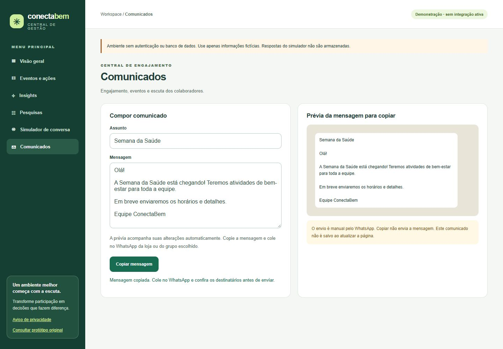
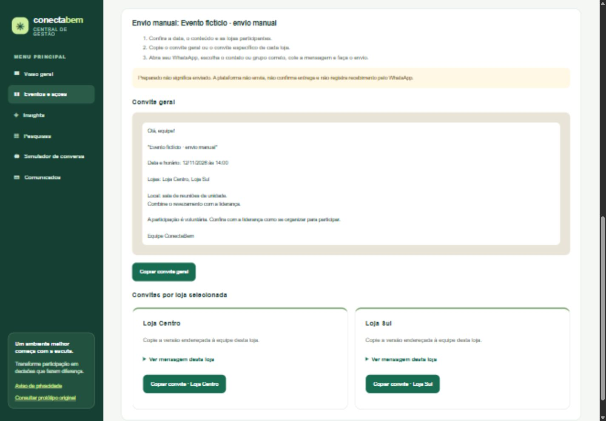

# Comunicados e eventos sem a API do WhatsApp

## Copiar um comunicado

Abra Comunicados, preencha assunto e mensagem e use **Copiar mensagem**.
A prévia acompanha a digitação e o texto copiado é o mesmo da prévia, incluindo
as quebras de linha. Cole no contato ou grupo correto do WhatsApp e faça o envio
manualmente. Copiar não envia e o comunicado não é salvo ao atualizar a página.

Se a API de clipboard do navegador não estiver disponível ou for bloqueada, a
interface mostra um campo selecionável para copiar com Ctrl+C ou pelo menu do
dispositivo. Há confirmação de sucesso, erro explícito e estado de cópia em curso.

## Criar o evento e continuar até o envio manual

1. Abra **Eventos e ações** e preencha nome, lojas participantes, data/horário e
   orientações. Inclua o local do evento na descrição.
2. Selecione uma ou mais lojas. “Todas as lojas” seleciona as três lojas de exemplo.
3. Use **Salvar evento e preparar envio**. O evento passa ao estado local
   **Preparado para envio manual** e abre o convite.
4. Revise e use **Copiar convite geral** ou **Copiar convite · [loja]**. A versão
   específica menciona somente a loja correspondente, sem listar outras lojas.
5. No seu WhatsApp, selecione o contato/grupo, cole o texto e envie. O sistema não
   abre conversas, não seleciona destinatários e não envia automaticamente.

Para continuar depois, abra o evento salvo e use **Ver convite para copiar**.
Para um rascunho antigo, use **Continuar preparação**, confira os dados e salve
preparando o envio. **Editar evento** permite ajustar um evento já preparado;
é necessário salvar novamente para gerar um convite atualizado.

## Persistência e limites

- Eventos, lojas selecionadas e estado de preparação são salvos no `cb_events`
  deste navegador. Não são cadastros em banco nem ficam disponíveis em outros
  dispositivos ou para as próprias lojas. As lojas existentes ainda são exemplos.
- Rascunhos antigos sem ID, seleção múltipla ou status permanecem compatíveis.
  Datas antigas em formato brasileiro podem ser retomadas no editor.
- Edição de um registro alterado em outra aba é bloqueada para evitar sobrescrita.
- “Preparado” não significa “enviado”. Não há confirmação de envio, entrega,
  leitura, presença ou coleta de respostas. Insights não inventa indicadores para
  esses eventos, mesmo depois da cópia manual.
- Uma API oficial não é necessária para copiar e enviar manualmente. Um banco,
  autenticação, lojas reais e permissões continuam necessários para operação
  compartilhada com dados reais.

## Verificação

35 testes automatizados aprovados, incluindo seleção de várias lojas,
serialização do estado preparado, compatibilidade com registros antigos,
rejeição de lojas inválidas/duplicadas e geração de convites com data, descrição
e somente as lojas selecionadas. TypeScript e build de produção também verificados.
Os testes de clipboard e navegação são conferidos no navegador com dados fictícios;
a falta de permissão de clipboard é tratada no componente, sem afirmar que a
interface consegue confirmar o envio no WhatsApp.

Na inspeção foram conferidos o texto copiado em Comunicados, a preservação de
quebras de linha e a atualização automática da prévia. Um evento fictício foi
preparado para Centro e Sul; o convite copiado para Sul não continha Centro nem
Norte. Após atualizar a página, o evento manteve as lojas e o status preparado.
O rascunho anterior abriu no editor com seus campos preservados. O navegador
bloqueou o cadastro sem seleção de loja com uma mensagem explícita.

O layout do envio manual também foi verificado em largura móvel de 390 px,
sem transbordamento horizontal (375 px úteis). Não foram capturados erros ou
avisos de console nos fluxos inspecionados. O bloqueio de permissão de clipboard
não foi forçado no navegador; o caminho alternativo foi implementado e compilado.

