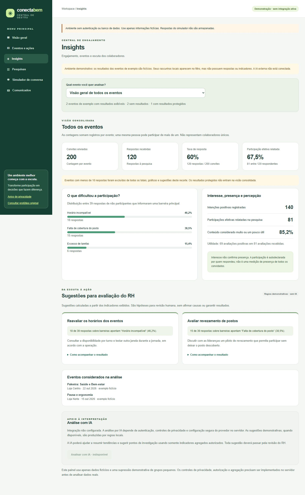

# Aba Insights — escopo e validação

## Experiência disponível

- Aba dedicada no menu, também acessível por “Explorar insights” na visão geral.
- Filtro por evento ou “Visão geral de todos os eventos”.
- Indicadores, barreiras e sugestões recalculados para o recorte selecionado.
- Convites, respostas à pesquisa, intenção e presença autodeclarada distintos.
- Taxas consolidadas calculadas pelas contagens totais, sem média simples das taxas.
- Denominadores visíveis e aviso de que os totais por evento não são pessoas únicas.
- Sugestões com evidência numérica, proposta de ação e orientação de acompanhamento.
- Rascunhos do navegador incluídos no filtro, sem inventar respostas para eles.
- Estados de carregamento, erro de leitura local, ausência de resultados e grupo pequeno.

## Origem dos dados e privacidade

Os eventos com métricas são **exemplos fictícios**, isolados em
`lib/insights/demo-data.ts`. Os rascunhos vêm da chave `cb_events`, já usada no
protótipo. Respostas do simulador não alimentam o painel e não foram persistidas.

O grupo mínimo de demonstração é 10 respostas por evento. Eventos abaixo do
limiar não apresentam métricas nem sugestões e são excluídos de todos os totais
consolidados. Eventos sem respostas também não recebem resultados artificiais.
As mesmas regras de exclusão alimentam gráficos e sugestões.

Isso é uma demonstração do comportamento de supressão. As fixtures, inclusive
as dos grupos pequenos, estão no bundle do navegador e não contêm dados reais.
Este código de cliente **não é uma fronteira de segurança**. A operação real
exige agregação no servidor, autorização/RLS e avaliação de inferência por filtros,
categorias, datas e comparações; não deve enviar respostas ou grupos protegidos
para o navegador. O limiar não comprova anonimização.

## Sugestões e IA

As sugestões atuais são regras locais transparentes, identificadas na interface
como **“Regras demonstrativas · sem IA”**. São destacadas as duas barreiras mais
citadas. Taxa de resposta menor que 60% sugere investigar adesão; utilidade
percebida menor que 80% sugere revisar conteúdo. Esses limites são heurísticas
ilustrativas para validar a experiência, não benchmarks científicos ou diagnósticos.
Os valores usados e os denominadores estão na evidência de cada sugestão.

As propostas não afirmam causalidade e requerem avaliação humana. Nenhuma ação
é criada ou executada automaticamente.

O painel de IA informa que a integração não está configurada e deixa a ação
desabilitada com explicação acessível. Não há chamada a provedor, envio externo
de dados ou endpoint sem autenticação para consumir uma chave de IA.

Para ativar IA real em uma fase posterior:

1. Implementar autenticação, escopo da empresa e acesso a agregados no servidor.
2. Revisar os dados permitidos para envio, contrato e configuração do provedor.
3. Configurar segredo somente no servidor; exigir autorização, limites de uso e
   tratamento de falhas antes de permitir chamadas.
4. Enviar somente métricas agregadas aprovadas do recorte selecionado; excluir
   nomes, telefones, comentários livres e quaisquer dados protegidos.
5. Validar a resposta do provedor, indicar seu caráter assistivo e exigir revisão
   humana, sem permitir invenção de métricas ou afirmações causais.

## Validação

TypeScript aprovado e **31 testes aprovados**, incluindo os 19 testes existentes.
O build inicial foi aprovado. Após os últimos ajustes, houve um bloqueio de pasta
em `.next` no Windows; o servidor local foi encerrado e o build foi executado
novamente, com sucesso, para validar a versão final.

Os 12 testes novos cobrem consistência das fixtures, filtro, taxas ponderadas,
distinção entre intenção/presença/resposta, supressão, exclusão dos grupos pequenos
dos totais, estados sem dados, limiar mínimo, denominadores nulos, evidências das
sugestões e preservação das fontes ao alternar filtros.

Inspeção no navegador: visão consolidada com 200 convites e 120 respostas de
exemplo; evento “Pausa e ergonomia” com 80 convites, 40 respostas e sugestões
específicas; “Roda de conversa” com resultados protegidos; rascunho local sem
resultados. Nenhuma informação real de colaboradores foi utilizada.

Também foram verificados o atalho do dashboard, a expansão de “Como acompanhar
o resultado” e o layout em 390 × 844 e 1440 × 1000. Não houve transbordamento
horizontal: largura útil/conteúdo de 375 px no móvel e 1425 px no desktop.
Nenhum erro ou aviso foi capturado no console durante a inspeção.

Não foram implementados relatórios com banco de dados, análise por IA externa
ou gravação das sugestões em um Plano de Ação neste incremento.
