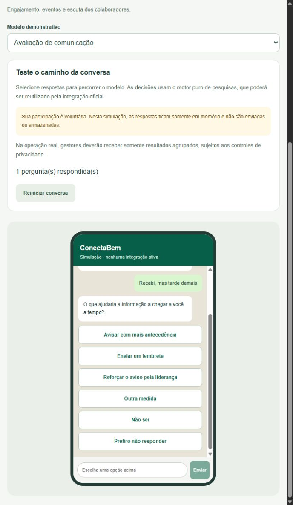

# Revisão semântica dos questionários — 25/10/2026

Correção motivada pela avaliação de clareza apresentada a quem não recebeu o
aviso a tempo. Foram revisadas todas as perguntas, alternativas e transições dos
três modelos ativos em `lib/surveys/templates.ts`. Catálogo e simulador continuam
consumindo essas mesmas definições, sem um fluxo paralelo na interface.

## Decisões de conversa

| Modelo / resposta | Pergunta seguinte ou comportamento |
|---|---|
| Comunicação: recebeu a tempo | Avaliar clareza do aviso |
| Comunicação: recebeu tarde ou não recebeu | Como melhorar a entrega; nunca pedir avaliação de clareza |
| Comunicação: não lembra ou prefere não responder | Preferência de canal, sem avaliar uma mensagem desconhecida |
| Clareza: parcialmente ou não | Identificar a informação que precisa melhorar |
| Clareza: sim, não sabe avaliar ou prefere não responder | Preferência de canal, sem pressupor um problema |
| Evento: participou integralmente | Avaliar utilidade e aprofundar conforme essa avaliação |
| Evento: pouco ou nada útil | Perguntar o que faltou, sem oferecer uma resposta de que tudo foi ótimo |
| Evento: participou parcialmente | Avaliar apenas a parte acompanhada e perguntar por que acompanhou somente parte |
| Evento: não participou | Perguntar a barreira, sem pedir avaliação do conteúdo |
| Barreira: horário, posto, tarefas, interesse ou aviso | Aprofundamento específico, sem confundir excesso de tarefas com falta de cobertura |
| Motivo pessoal, outro motivo ou recusa de detalhes | Não solicitar explicação; seguir para pergunta geral ou comentário opcional |
| Intenção: sim | Oferecer lembrete demonstrativo |
| Intenção: indecisão | Perguntar o que gera dúvida, seguido apenas de aprofundamento pertinente |
| Intenção: não | Motivo opcional e aprofundamento pertinente; sem oferecer lembrete do evento recusado |

Todas as perguntas de escolha têm “Prefiro não responder”. Comentários continuam
opcionais. Nenhuma conversa supera **cinco perguntas**, incluindo o comentário;
nenhuma pergunta se repete no mesmo caminho. Durações têm intervalos sem sobreposição.

## Validação executada

- `npm run check`: TypeScript, **19 testes aprovados** e build de produção aprovados.
- Testes percorrem todos os caminhos dos três modelos e verificam limite de
  perguntas, término, ausência de ciclos, compatibilidade semântica de clareza,
  distinção entre participação parcial/integral/ausência, recusa de detalhes,
  alternativas de saída e lembretes apenas após intenção positiva.
- Navegador com build de produção: conferidos os caminhos “não recebi”, “recebi
  tarde”, “recebi a tempo → clareza parcial”, “não participarei → prefiro não
  responder → pular comentário” e “participei parcialmente → não foi útil →
  retornei ao posto → revezamento”. Nenhum erro/aviso de console capturado.

O protótipo histórico em `public/demo.html` permanece preservado como referência;
esta revisão se aplica aos modelos ativos da aplicação React. Não altera banco,
integrações externas ou persistência de respostas.
